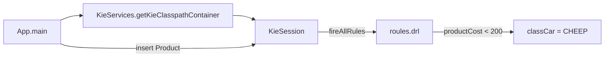

# JBossDrools6

A small JBoss Drools 6 (KIE API) learning project. The `DDEngine` module bootstraps a rule engine session from the classpath, inserts a `Product` fact and lets a DRL rule classify it into a price category.

It is based on the "My First Drools Project" example (chapter 2) from the *Mastering JBoss Drools 6* developer guide, adapted with its own model and rule.

## How it works



- `META-INF/kmodule.xml` declares an empty KIE module, so Drools builds a default KieBase and KieSession from every `.drl` file on the classpath.
- `roules.drl` contains one rule, **Classify Product - Low**: any `Product` with `productCost < 200` gets `ClassCar.CHEEP`.
- `App` creates `new Product("Car", 12.8, 33.8)`, prints its category (`NOTDEFINED`), fires the rules and prints the number of rules executed and the new category (`CHEEP`).

`ClassCar` also defines `EXPENCIVE` and `MIDCLASS`; no rule assigns them yet.

## Tech stack

| Component | Version |
|-----------|---------|
| Java | 8 (the project was run with OpenJDK 8) |
| Drools / KIE API | 6.x, versions inherited from the parent POM |
| Dependencies | `kie-api`, `drools-compiler`, `drools-core`, `cdi-api`, `weld-se-core`, `junit` |
| Build | Maven |

## Project structure

```
DDEngine/
├── pom.xml
└── src/main/
    ├── java/org/drools6/ddengine/
    │   ├── App.java               # bootstraps the KieSession and fires rules
    │   ├── enums/ClassCar.java    # NOTDEFINED, EXPENCIVE, MIDCLASS, CHEEP
    │   └── model/Product.java     # name, cost, price, classCar
    └── resources/
        ├── META-INF/kmodule.xml   # default KIE module
        └── roules.drl             # classification rule
```

## Prerequisites

- JDK 8
- Maven 3
- The parent POM `org.drools.devguide:chapter-02:1.0.0` and the `org.drools.devguide:model` artifact installed in your local Maven repository. They come from the *Mastering JBoss Drools 6* example code and are **not** published to Maven Central; the Drools dependency versions are defined there. Install them first (run `mvn install` in the book's example code root), otherwise the build fails with an unresolvable parent POM.

## Build and run

```bash
cd DDEngine
mvn clean package exec:java -Dexec.mainClass="org.drools6.ddengine.App"
```

Expected output:

```
Bootstrapping the rule Engine...
Item Category: NOTDEFINED
Number of Rules executed = 1
Item Category: CHEEP
```

## Setup notes (Ubuntu, Java 8)

Commands used while setting up the environment for this project.

Create a new Maven project from the quickstart archetype:

```bash
mvn -B archetype:generate -DarchetypeGroupId=org.apache.maven.archetypes -DgroupId=org.drools.Myapp -DartifactId=myapp
```

Check the Ubuntu release:

```bash
lsb_release -a
```

Install and switch to Java 8:

```bash
sudo apt-get update
sudo apt install software-properties-common
sudo apt update
sudo apt install openjdk-8-jdk

update-java-alternatives --list
sudo update-java-alternatives --set java-1.8.0-openjdk-amd64

export JAVA_HOME=/path/to/openjdk-8-directory
export PATH=$JAVA_HOME/bin:$PATH

echo $JAVA_HOME
echo $PATH
java -version
```

Build and run:

```bash
mvn clean install
mvn clean package exec:java -Dexec.mainClass="org.drools6.ddengine.App"
```

## License

Released under the MIT License. See [LICENSE](LICENSE).
